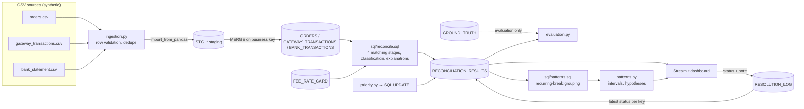

# Truva

Demo Video Link : https://youtu.be/zyyJvW03y1A

**Every number tells a story.**

Truva (கணக்கு, "accounts") is a three-way payment reconciliation tool built on **Exasol Personal**. It loads a
merchant's order ledger, payment-gateway report and bank statement, matches them inside Exasol with SQL, explains
every mismatch with evidence, ranks the open exceptions by investigation priority, and keeps an audit trail of
analyst decisions.

*ExaThon India 2026 · Track 01 — Money, Risk & Regulation · Problem: three-way payment reconciliation with break explanations.*

> All data in this repository is synthetic. There are no real customers, bank accounts or credentials.

---

## The problem

An Indian online merchant takes payments through a gateway (UPI, cards, net-banking, wallets). Money then arrives in
the bank in **settlement batches**, after fees and GST are deducted, usually T+2. The three records rarely agree:

| What goes wrong | What it looks like |
|---|---|
| Fees and GST netted at source | Gateway or bank amount is short of the order amount |
| Batch settlements | One bank credit covers ~90 payments, net of refunds and chargebacks |
| Delays | Settlement arrives days after the expected date |
| Duplicates | A customer is charged twice, or a batch is credited twice |
| Missing records | An order with no payment; a payment with no order; a batch that never arrives |
| Reversals | A cancelled order whose payment was captured; a chargeback the ledger doesn't know about |

Finance teams reconcile this by hand in spreadsheets every month-end. The cost is close delays, unrecovered refunds
and cash nobody can explain. Truva automates the matching and, more importantly, tells the analyst **why** each
break happened and **which ones to look at first**.

## What Truva does

1. **Ingest:** validates each CSV row by row (money must be a decimal with ≤ 2 places, dates must parse, currency must be INR, gateway net must equal gross − fee − GST, …). It rejects bad rows with a reason and line number, drops exact duplicates, rejects conflicting duplicates, and `MERGE`s the rest into Exasol on business keys, so reloading a file is a no-op.
2. **Reconcile inside Exasol, in four stages:**
   1. **Exact:** order reference (trimmed, upper-cased) and amount equal.
   2. **Tolerance:** reference equal, amount within a configurable tolerance (default ₹1.00).
   3. **Settlement batches:** the gateway batch net (payments − fees − GST − refunds − chargebacks) is matched to the bank line whose narration carries the batch id. A credit with *no* reference is linked only when its amount is identical, its value date falls inside the window, and the pair is unique in both directions (constrained matching).
   4. **Conservative fuzzy:** a payment with a blank or mistyped reference is linked to an order only if it is the single same-amount, same-method candidate within 15 minutes, *and* that order has no other candidate. Ambiguous pairs are left as exceptions on purpose.
3. **Classify** every order, gateway transaction, settlement batch and bank line exactly once per run: `MATCHED`, `MISSING_FROM_GATEWAY`, `MISSING_FROM_BANK`, `AMOUNT_MISMATCH`, `POSSIBLE_DUPLICATE`, `DELAYED_SETTLEMENT`, `POSSIBLE_FEE_DIFFERENCE`, `REVERSAL_OR_CANCELLATION`, `UNRESOLVED` (plus the non-exception `AWAITING_SETTLEMENT`).
4. **Explain:** each result stores the source ids, the expected, actual and discrepancy amounts, the dates, the batch, the matching stage, a plain-English explanation and an evidence string. Explanations are tagged **Confirmed** (visible in the records) or **Suspected** (a likely cause inferred by a rule). Truva never claims fraud.
5. **Prioritise:** a transparent 0–100 score (amount + ageing + severity + close-period impact), banded High/Medium/Low, with the reason shown. It is an investigation-priority heuristic, not a fraud probability.
6. **Resolve:** analysts set a status and a note. Every change is appended to `RESOLUTION_LOG`, and the latest decision is carried forward to future runs by a stable exception key.
7. **Evaluate:** compares a run against the generator's separate ground-truth labels (precision, recall, confusion matrix, false positives, missed issues). The matching SQL never reads the labels, and a test enforces that.
8. **Recurring-Break Intelligence:** groups a run's *unresolved* exceptions in Exasol by payment method, settlement batch, amount-difference shape and ageing. It reports only groups that stand out once chance is allowed for, and words each one as a labelled hypothesis with its evidence, a suggested investigation and the check that would confirm or refute it. See [below](#recurring-break-intelligence).

## Measured results (bundled sample, seed 42)

All figures were measured on 2026-10-21 on an Apple M4 Mac (16 GB) running Exasol Personal 2026.2.0 locally in a
4-vCPU / 6 GB VM. Reproduce them with `.venv/bin/python -m kanakku demo`.

| Metric | Value |
|---|---|
| Orders loaded (valid / rows read) | 10,005 / 10,021 (10 rejected, 6 exact duplicates dropped) |
| Gateway transactions | 10,503 / 10,515 (6 rejected, 6 exact duplicates dropped) |
| Bank lines | 947 / 954 (4 rejected, 3 exact duplicates dropped) |
| Orders matched | **9,475 / 10,005 (94.70%)**: 9,224 exact, 200 within tolerance, 51 fuzzy (suspected) |
| Settlement batches matched | 96 / 113 (88 by reference, 8 by constrained amount + date) |
| Exceptions | 670 (165 High, 364 Medium, 141 Low) |
| Open discrepancy exposure | ₹22,81,681.69 |
| Reconciliation time inside Exasol | ~1.0–1.3 s per run (all four stages + scoring) |
| Detection precision / recall / F1 vs ground truth | **0.970 / 1.000 / 0.985** (650 TP, 20 FP, 0 missed) |
| Issue-code accuracy on detected exceptions | 100% |
| Recurring-break groups checked / supported | 172 / 2 (both Moderate; see [Recurring-Break Intelligence](#recurring-break-intelligence)) |
| Automated tests | 142 passed (116 unit + 26 Exasol integration) |

**Read these numbers honestly.** The generator and the rules were written by the same person, so the scores show
that the engine handles the *known* scenarios consistently. They do not measure accuracy on real-world data. All 20
false positives come from five deliberately ambiguous pairs: two same-amount, same-method orders two minutes apart
whose payments both lack a reference. Truva refuses to guess and raises both as exceptions. That trade-off is
intended.

## Architecture



Everything Truva owns lives in one Exasol schema (`KANAKKU` by default). See
[docs/ARCHITECTURE.md](docs/ARCHITECTURE.md) for tables, the SQL stages and design decisions.

### How Exasol is used

- **Primary store** for sources, staging, results, run history, ingestion audit and the resolution log.
- **All matching and aggregation runs as SQL in Exasol:** window functions (`ROW_NUMBER`, `COUNT(*) OVER`, `FIRST_VALUE`) for duplicate ranking and uniqueness checks, `REGEXP_SUBSTR` to pull batch and payment references out of bank narrations, `DAYS_BETWEEN` / `SECONDS_BETWEEN` / `ADD_DAYS` for ageing and time windows, `MERGE` for idempotent loads and status carry-forward, and `CREATE OR REPLACE TABLE … AS` work tables.
- **A user-defined SQL function** (`FMT_INR`) formats rupee amounts inside explanations.
- **Bulk loading** through PyExasol's `import_from_pandas` (HTTP transport) into staging tables.
- **Transactions:** each run executes with autocommit off. A failure rolls back every partial result and marks the run `FAILED` (covered by a test).
- **Scoring in SQL:** the priority UPDATE is generated from the same weight tables as the Python reference implementation, and a test checks they agree on every row.
- **Pattern grouping in SQL:** recurring-break intelligence is one CTE query (`sql/patterns.sql`). It uses `CROSS JOIN` grids, so groups with zero exceptions still count in the baseline, window sums (`SUM(...) OVER (PARTITION BY ...)`) for denominators, and `GROUP_CONCAT` for example ids and issue mixes. It runs in about 0.1 s on the sample.

## Setup

Requirements: macOS 15+ on Apple silicon with ≥ 8 GB RAM (Exasol Personal local mode; Linux and Windows also
work), Python 3.11+, and roughly **10 GB free disk** for the Exasol VM image and data.

```bash
# 1. Exasol Personal (official launcher, installs to ~/.local/bin)
curl https://downloads.exasol.com/exasol-personal/installer.sh | sh
```

The launcher is not on your `PATH` by default, so this README always calls it as `~/.local/bin/exasol`. To be able
to type plain `exasol`, add the folder to your `PATH` once (zsh), then open a new terminal:

```bash
echo 'export PATH="$HOME/.local/bin:$PATH"' >> ~/.zshrc
```

```bash
# 2. Start a local database (smaller VM than the default; adjust to your machine)
~/.local/bin/exasol install local --cpu-count 4 --memory-mb 6144 --data-size-gb 20
```

```bash
# 3. Python environment
python3 -m venv .venv && .venv/bin/pip install -r requirements.txt
```

```bash
# 4. Credentials: copy the template, then paste the password from
#    ~/.exasol/personal/deployments/default/secrets.json (key "dbPassword")
cp .env.example .env
```

`~/.local/bin/exasol info` shows the host and port (default `127.0.0.1:8563`, user `sys`). The local database uses a self-signed
certificate, so `.env.example` sets `EXASOL_CERT_VALIDATION=false`.

## Run

```bash
# Everything in one go: generate → load (replace) → reconcile → evaluate
.venv/bin/python -m kanakku demo
```

```bash
# The dashboard
.venv/bin/python -m streamlit run app/streamlit_app.py
```

Individual steps:

```bash
.venv/bin/python -m kanakku generate --seed 42 --orders 10000   # writes data/sample/*.csv
```

```bash
.venv/bin/python -m kanakku load --replace                       # validate + MERGE into Exasol
```

```bash
.venv/bin/python -m kanakku reconcile --tolerance 100 --delay-days 2
```

```bash
.venv/bin/python -m kanakku evaluate
```

```bash
.venv/bin/python -m kanakku patterns            # recurring-break intelligence; add --all to list every group
```

Stop or restart the database:

```bash
~/.local/bin/exasol stop
```

```bash
~/.local/bin/exasol start
```

## Dashboard

| Page | What it shows |
|---|---|
| **Overview** | Matched count, match rate, unresolved exceptions, open exposure, exceptions by issue, priority mix, daily trend, ageing |
| **Data Import** | Upload the three CSVs (plus optional ground truth). Shows per-row validation results; loads into Exasol. One-click bundled sample or freshly generated data |
| **Reconciliation** | Tune tolerance, delay, batch window, fee band and fuzzy matching. Runs the pipeline and shows results by stage and the run history |
| **Investigation Queue** | Prioritised, filterable (issue, band, status, level) and searchable exceptions; CSV export |
| **Exception Details** | Order, gateway and bank records side by side; explanation (Confirmed or Suspected), evidence, score breakdown; status and notes with full history |
| **Recurring Breaks** | Supported patterns among unresolved exceptions, each with evidence, a labelled hypothesis, a suggested investigation, what would confirm or refute it, and buttons to open the largest examples; plus a table of every group checked and why it was or wasn't reported |
| **Data Quality & Evaluation** | Rejected rows with reasons, duplicates, precision and recall per issue code, confusion matrix, false-positive and missed lists |

Every number on every page is queried live from Exasol.

## Priority score

| Component | Points | Rule |
|---|---|---|
| Amount at risk (exposure) | 0–40 | ≥ ₹50,000 → 40 · ≥ ₹10,000 → 32 · ≥ ₹2,000 → 24 · ≥ ₹500 → 16 · ≥ ₹100 → 8 · > 0 → 4 |
| Ageing | 2–25 | ≥ 30 days → 25 · ≥ 14 → 18 · ≥ 7 → 12 · ≥ 3 → 6 · else 2 |
| Severity | 6–25 | Missing from bank 25 · Reversal/cancellation 22 · Duplicate 20 · Amount mismatch 18 · Missing from gateway 15 · Unresolved 15 · Fee difference 8 · Delayed 6 |
| Financial-close impact | 3–10 | Dated in the period being closed (default: the month before the as-of date) 10 · earlier, already-closed period 7 · after the close period 3 |

**Band:** High ≥ 70, Medium ≥ 50, Low < 50. Delayed-but-arrived settlements have zero exposure, so they rank low. The
weights live in [`kanakku/priority.py`](kanakku/priority.py).

## Recurring-Break Intelligence

The queue ranks single exceptions. This feature asks a different question: **do the unresolved exceptions cluster
somewhere?** A cluster points at one upstream cause worth fixing once, instead of 80 items to clear one by one.

**What is grouped** (`sql/patterns.sql`, one query inside Exasol, unresolved exceptions of one run only):

| Dimension | Compared how | Notes |
|---|---|---|
| Payment method | Exceptions per order paid by the method, against the rate across all methods | Methods with a 0 bps fee on the rate card (UPI) are left out of the fee-difference baseline, because a fee difference cannot arise there |
| Settlement batch | Exceptions per order settled in the batch, against the rate across all batches | Shows the batch's issue mix and the batch's own status |
| Amount-difference shape | Share of an issue's mismatches that are short or over by &lt;1%, 1–5%, 5–20% or ≥20% of the expected amount | Only `AMOUNT_MISMATCH`. Fee differences are excluded, because their shape is how they were flagged |
| Ageing | Share of an issue's open backlog in each age bucket | |

The data has only one gateway, so "source" is covered by payment method and by entity level. A settlement-mode
dimension (instant vs batch) was left out on purpose: the engine judges bank-leg issues per order only for instant
settlements, so that grouping would restate the engine's own rule rather than find anything.

**When a group is reported.** A group needs at least 3 unresolved exceptions (adjustable). Its 95% Wilson lower bound
must also clear the comparison: above the overall rate for rate groups, or above 50% for share groups. The bound is
tightened with a Bonferroni correction for the number of groups compared, so one batch out of ~100 that looks bad
by chance is not reported. A group is labelled *Strong* when the lower bound is at least 2× the overall rate (or at
least 75% of the issue), and *Moderate* otherwise.

**How it is worded.** Every reported group has four parts: **Evidence** (numbers only), a **Hypothesis** (always
prefixed "Hypothesis (not verified)"), a **Suggested investigation**, and **What would confirm or refute it**. A test
checks that no generated text contains "root cause", "proven", "definitely" or "fraud".

**Measured on the bundled sample (run 10, 2026-10-21).** 172 groups were checked and 2 are supported, both Moderate:

1. **Payment method · POSSIBLE_DUPLICATE · UPI:** 79 unresolved duplicates among 4,992 UPI orders (1.58%), against
   0.80% overall, or 2.0×. The 95% lower bound is 1.23%.
2. **Ageing · REVERSAL_OR_CANCELLATION · 30–59 days:** 62 of 100 (62%). The lower bound is just above 50%.

All settlement-batch "hotspots" (the largest was 10 exceptions in an 82-order batch) are rejected as within chance.

**About finding 1:** it is real in the data, but the data is synthetic. I traced it to the generator. It assigns
scenarios to orders in sequence, and the fee-difference scenario (card, net-banking and wallet orders only) runs
just before the duplicate scenario, so the duplicates were drawn mostly from UPI orders: 79 UPI and 1 card. The
feature found that skew without being told about it, but it says nothing about real UPI integrations.

**How detection is tested.** The integration tests plant a pattern in a results-only test run: 20 wallet duplicates
in one batch, 5 of them resolved. They check that the method pattern and the batch hotspot are found, that resolved
items are excluded, and that the fee baseline skips 0-fee methods. They also check that the SQL counts equal direct
counts on a real reconciliation run.

## Tests

```bash
.venv/bin/python -m pytest -q                 # all tests (Exasol tests skip if the DB is down)
```

```bash
.venv/bin/python -m pytest -q -m "not exasol" # unit tests only
```

The integration tests build a throw-away `KANAKKU_TEST` schema, load a hand-built scenario where every rule should
fire exactly once, and drop the schema afterwards. They cover:

- exact, tolerance (100 vs 101 paise), batch-by-reference, constrained-batch and fuzzy matching, including an ambiguous pair that must *not* match
- duplicates (gateway and bank), fee differences, chargebacks, cancellations, refunds, and instant settlements that are missing or delayed
- monetary round-trip, idempotent reloads, stable reruns, resolution logging and carry-forward
- rollback of a failed run, and SQL-vs-Python priority parity

The unit tests cover money parsing, malformed CSVs, generator reproducibility, score thresholds, the evaluation
maths, and the recurring-break statistics and wording.

## Project layout

```
kanakku/            Python package
  config.py         env-based settings, matching parameters
  money.py          paise parsing/formatting (no floats)
  db.py             PyExasol connection, script runner
  schema.py         idempotent DDL + rate card
  generator.py      synthetic data + ground truth
  ingestion.py      CSV validation, staging, MERGE
  reconciliation.py runs sql/reconcile.sql atomically
  priority.py       score weights (Python + generated SQL)
  evaluation.py     precision / recall vs ground truth
  resolution.py     status changes → RESOLUTION_LOG
  patterns.py       recurring-break intelligence (intervals, hypotheses)
  queries.py        read-only SQL for the dashboard
sql/                schema.sql, reconcile.sql, functions.sql, patterns.sql
app/                Streamlit dashboard (streamlit_app.py + views/)
tests/              pytest (unit + Exasol integration)
data/sample/        bundled synthetic CSVs, ground truth, manifest
docs/               architecture, demo script, viva guide
deck/               pitch deck (.pptx)
```

## Limitations

- **Synthetic data only.** The scenarios mirror the rules, so the evaluation measures consistency, not real-world accuracy. Real gateway exports (Razorpay, PayU, Cashfree, …) would each need a column mapping.
- **INR only.** Multi-currency, FX and partial settlements are out of scope. A batch credited in two parts is flagged as a possible duplicate.
- **Fuzzy matching is deliberately narrow** (exact amount, same method, ±15 minutes, unique on both sides). It misses typo'd references with near-identical neighbours. That is by design.
- **Constrained batch matching needs an exact amount,** so an unreferenced *and* short-paid credit shows up as a missing batch plus an unresolved bank line.
- **The fee check uses a static rate card** (`FEE_RATE_CARD`). Negotiated or tiered pricing would need per-merchant rates.
- **No authentication or multi-user locking.** It is a single-analyst tool, as scoped for a two-day build.
- **The priority score is a heuristic** with hand-chosen weights. It has not been calibrated against real outcomes.
- **Recurring-break intelligence finds concentrations, not causes.** It compares groups one dimension at a time, so it does not model combinations (e.g. method × batch) or trends across runs. The hypothesis texts are fixed templates per dimension and issue.

## License

[MIT](LICENSE)
